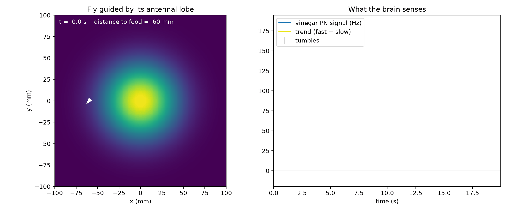

# Ocellus: a fruit fly simulator

A fruit fly whose sense of smell is a spiking model of its real brain wiring, hunting for food in a 3D kitchen in your browser.

**[Try it live → ocellus-theta.vercel.app](https://ocellus-theta.vercel.app)**

Drop a piece of fruit anywhere in the kitchen: on a counter, the table, a chair, the top of the fridge or the floor. The fly smells it with a 625-neuron circuit extracted from the *Drosophila* male central nervous system connectome, and flies toward it using the same strategy real flies and bacteria use: keep going while the smell gets stronger, turn when it fades.

*(An ocellus is one of the small simple eyes on top of an insect's head.)*



<sub>The 2D Python version of the experiment that the web app grew out of. Red: the fly's path; the panel shows its projection-neuron signal.</sub>

## How it works

```
odor plume ──▶ olfactory receptor neurons (ORNs, left and right antenna)
                        │  Poisson spikes
                        ▼
          625-neuron spiking circuit from the MaleCNS connectome
                        │
                        ▼
          vinegar projection neurons (DM1 and VA2 glomeruli)
                        │  firing rate
                        ▼
          trend = fast average − slow average     ("is the smell getting stronger?")
                        │
                        ▼
          run-and-tumble: tumble less when the trend is up, more when it's down
```

1. **The connectome.** Synaptic weights come from the [MaleCNS v1.0](https://www.janelia.org/project-team/flyem) connectome. Each neuron is a leaky integrate-and-fire point neuron with the parameters of Shiu et al., *Nature* 2024.
2. **Calibration.** A point-neuron model can't represent every synapse faithfully, so [`flybrain/calibrate.py`](flybrain/calibrate.py) drops connections it can't model:
   - slow neuromodulators (dopamine, octopamine, serotonin)
   - Kenyon cell to Kenyon cell synapses
   - feedback onto sensory terminals
   - mostly electrical or dendro-dendritic links in the antennal lobe

   It then caps each neuron's total excitatory input at the 95th percentile. The full record is in `data/calibration.json` and in the `calibration` block of the exported circuit.
3. **Reduction.** [`sims/reduce_brain.py`](sims/reduce_brain.py) drives the whole brain with many vinegar stimuli and keeps only the neurons that ever fire: 625 of them. The reduced circuit reproduces the full brain's projection-neuron signal on a stimulus it never saw.
4. **The browser.** [`sims/export_brain.py`](sims/export_brain.py) writes the circuit as a 234 KB JSON file. [`web/lib/brain.ts`](web/lib/brain.ts) is a line-for-line TypeScript port of the Python simulator. It runs in a Web Worker at 0.1 ms resolution, in real time. The `/validate` page checks it against the Python reference rates.
5. **Behavior.** The fly reads the vinegar projection neurons and compares a 0.2 s running average with a 1 s one. A rising signal lowers its tumble rate, so it keeps flying straight. A falling signal raises the rate, so it turns sooner. In headless tests, 9 of 12 flies found food placed across the kitchen within 90 s, against 0 of 10 flies with the smell switched off.

### What's simplified

This is a toy built on real data, not a faithful fly. In particular:

- **Point neurons.** Neurons are single-compartment integrate-and-fire models: no dendrites, gap junctions or neuromodulation.
- **Two odor channels.** Only two ORN types, DM1 and VA2 (vinegar-responsive glomeruli), receive input.
- **A hand-written motor rule.** The step from brain signal to flight is a rule, not the connectome's motor circuits.
- **A simple plume.** The smell is a smooth plume that falls off exponentially with distance, not turbulent air.
- **Vision only for landing.** Within about 35 cm the fly "sees" the food and lands on it; vision isn't modelled otherwise.
- **Bigger than life.** The fly is drawn about 10× life size so you can find it.

## Using the app

| Action | How |
|---|---|
| Drop food | Click any flat surface (a ring shows where it will land) |
| Look around | Drag |
| Move | Scroll to zoom toward the cursor, **WASD** or arrow keys, **Q**/**E** for down/up, right-drag to pan |
| Jump to a view | **Views** menu or keys **1–7**: overview, sink, stove, side counter, table, fridge, floor |
| Pause / resume | **Space** |
| Follow the fly | **F**. The camera tracks the fly, ducks under furniture and swings away from walls |
| Reset the fly | **R** |
| Remove the food | **X** |
| Game mode | **G** |

**Game mode** swaps the minimal toolbar for a HUD:
- an objective card with a timer and a proximity bar
- a top-down mini-map with the fly's trail
- a live brain readout
- a console that logs what the simulation is doing: tumbles, the smell rising or fading, ORN rates, landing

The console accepts commands:

```
help                  list everything below
drop food table       also: counter, side counter, fridge, chair, floor
remove food
go fridge             also: overview, sink, stove, side counter, table, floor
pause | resume | follow | unfollow | reset | clear | about | exit
```

Press **`** to show or hide the console.

## Running it locally

### The web app

Everything the app needs is committed, including the exported circuit in `web/public/brain/`.

```bash
cd web
npm install
npm run dev        # http://localhost:3000
```

It's a static Next.js app with no server-side code, so `npm run build` produces something any static host can serve. It is deployed on Vercel with **Root Directory** set to `web`.

### The Python research code

Requires Python 3.13 and [uv](https://docs.astral.sh/uv/).

```bash
uv sync
uv run python sims/odor_tracking_pn.py     # run from the repo root
```

The scripts expect the connectome in `data/`, which is not in the repo because of its size:

- **Raw MaleCNS v1.0 exports:**
  - `body-annotations-male-cns-v1.0-minconf-0.5.feather`
  - `body-neurotransmitters-male-cns-v1.0.feather`
  - `connectome-weights-male-cns-v1.0-minconf-0.5.feather`
- **Derived from those:** `neurons.parquet` (one row per neuron) and `W.npz` (a sparse, signed weight matrix in the same order). The script that builds these two from the exports isn't in the repo yet.

From there, the pipeline is:

| Step | Script | Produces |
|---|---|---|
| Calibrate the weights | `sims/sweep_cap.py` (set `SAVE_PERCENTILE`), then `sims/fix_pn_loop.py` | `data/W_calibrated.npz`, `data/calibration.json` |
| Check the brain switches off after the smell | `sims/find_loop.py`, `sims/test_hysteresis.py` | diagnostics, `results/hysteresis.png` |
| Map smell to neuron responses | `sims/calibrate_intensity.py`, `sims/calibrate_steering.py` | `results/*_calibration.csv` |
| Odor tracking in 2D | `sims/odor_tracking_pn.py` (also `odor_tracking.py`, `odor_tracking_temporal.py`) | `results/odor_tracking_*.png`, `.npz` |
| Animate a trial | `sims/animate.py` | `results/odor_tracking_trial1.gif` |
| Reduce to the vinegar circuit | `sims/reduce_brain.py` | `data/active_neurons.npy` |
| Export for the web | `sims/export_brain.py` | `exports/vinegar_circuit.json`; copy it to `web/public/brain/` |


## Credits

- **Connectome:** MaleCNS v1.0. Berg et al., *Cell* 2026, from HHMI Janelia, the University of Cambridge, MRC LMB and Google Research. Licensed under [CC-BY 4.0](https://creativecommons.org/licenses/by/4.0/).
- **Neuron model parameters:** Shiu et al., "A *Drosophila* computational brain model reveals sensorimotor processing", *Nature* 2024.
- **Web stack:** [Next.js](https://nextjs.org), [three.js](https://threejs.org) and [React Three Fiber](https://r3f.docs.pmnd.rs).

## License

The code is released under the [MIT License](LICENSE). Data derived from the MaleCNS connectome, including the exported circuit in `exports/` and `web/public/brain/` and the files in `results/`, stays under [CC BY 4.0](https://creativecommons.org/licenses/by/4.0/) and must credit the MaleCNS authors. See [LICENSE](LICENSE) for details.
